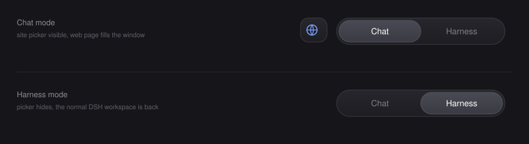

# dsh-chat-shell

> A **Chat / Harness** switch for DeepSeek Harness:
> embed DeepSeek, Doubao or ChatGPT in the whole window, and get back to Harness
> with one click — without losing your conversation, your scroll position or a
> reply that is still streaming.

<p>
  
  
  
  
</p>



---

## What it does

DeepSeek Harness is one window with one interface. This plugin adds a second one:
a glass segmented switch in the title bar, with the sites you use beside it.

```
Harness                            Chat
┌────────────────────────────┐    ┌────────────────────────────┐
│  应用  编辑   Chat│Harness  │    │  应用  编辑  ⬤▾  Chat│Harness│
├────────────────────────────┤    ├────────────────────────────┤
│                            │    │                            │
│   the untouched DSH UI     │ ⇄  │   a real browser showing   │
│   (sessions, tools, tasks) │    │   chat.deepseek.com        │
│                            │    │   (or Doubao / ChatGPT)    │
└────────────────────────────┘    └────────────────────────────┘
```

Both sides stay alive. Switching is a fade, not a page load:

* the DSH session, its scroll position and any running tool call are untouched;
* every AI website stays mounted, so an answer that is still being generated
  keeps generating while you are looking at Harness;
* each site has its own session partition, so three logins do not overwrite each
  other.

## Features

| | |
|---|---|
| **Segmented switch** | `Chat \| Harness`, centred in the title bar. Click either label, or drag the glass thumb and drop it where you want it. |
| **Site button** | Real brand mark + a caret, left of the switch. Open it to pick a site, or to add one of your own. |
| **Three presets** | DeepSeek, Doubao (豆包), ChatGPT — each in its own browser session. |
| **Add any website** | Paste a URL; the label is derived from the hostname. Custom sites are stored next to the presets. |
| **Instant switching** | Sites are mounted once and toggled with CSS, never torn down on a switch. |
| **Remembers everything** | Last mode, last site and your site list survive a reload. |
| **Follows the theme** | Light and dark are detected from the live page and re-applied whenever the app theme changes. |
| **Fails soft** | On a browser-hosted DSH (no desktop bridge) the switch simply hides itself instead of breaking the page. |

## Requirements

* **DeepSeek Harness desktop** 0.2.x — the embedded browser is provided by the
  Electron shell and does not exist in `dsh web`.
* Windows (the desktop build this was developed and tested against).

## Install

### With the plugin market / CLI

```bash
dsh plugin add dsh-chat-shell
```

### Manually (local folder)

1. Copy this folder into the profile's `node_modules`:

   ```
   %USERPROFILE%\.dsh\profiles\desktop\node_modules\dsh-chat-shell
   ```

2. Add the plugin to the profile patch, `…\profiles\desktop\cordis.patch.yml`:

   ```yaml
   - insert:
       - id: chat-shell
         name: dsh-chat-shell
   ```

3. Save. The desktop app hot-reloads the plugin graph, so the switch appears
   without restarting; if it does not, restart the app once.

## Use

* **Switch** — click `Chat` or `Harness`, or drag the thumb.
* **Pick a site** — click the round button left of the switch.
* **Add a site** — open the picker, choose `＋ 添加 AI 网页`, paste a URL, `Enter`.
* **Go back to Harness** — one click; nothing else changes.

The plugin keeps exactly one preference key in `localStorage`:

```jsonc
// dsh-chat-shell:state
{
  "mode": "chat",                                  // "chat" | "harness"
  "active": "deepseek",                            // id of the selected site
  "sites": [{ "id": "deepseek", "label": "DeepSeek", "url": "https://chat.deepseek.com/" }]
}
```

To reset everything, run `localStorage.removeItem("dsh-chat-shell:state")` in the
app's devtools and reload.

## Staying logged in (optional)

Out of the box the embedded browsers use an **in-memory** session partition, so
every restart of the app logs you out again. That is a property of the shell, not
of this plugin.

`scripts/patch-persistent-login.mjs` fixes it with a **one-line change** to the
shell, made on a copy, with the original archive kept for rollback:

```
- partition = `dsh-sidebar-browser-${randomUUID()}`;
+ partition = `persist:dsh-sidebar-browser-${createHash("sha1").update(workspace)…}`;
```

```bash
node scripts/patch-persistent-login.mjs status     # is the shell patched?
node scripts/patch-persistent-login.mjs build      # extract + patch (no swap)
node scripts/patch-persistent-login.mjs apply      # prepare the swap…
# …then double-click apply-patch.cmd and quit DSH (应用 → 退出)
```

Read **[docs/persistent-login.md](docs/persistent-login.md)** before running it:
it edits the installed application, it is Windows-only, and a DSH update
overwrites it (re-run `build` + `apply` afterwards). The plugin works without it.

## Limits worth knowing

* **Desktop only.** The switch needs the desktop bridge `dshDesktop.browser`,
  which the browser-hosted DSH does not expose. The plugin detects this and stays
  out of the way.
* **The bridge is not a documented API.** It is a stable-looking internal
  contract of the 0.2.x shell; a future DSH release may rename it. If that
  happens the switch hides itself rather than throwing.
* **The embedded browser is locked down by the shell** — no downloads, no
  permission prompts, no nested webviews, no HTTP authentication dialogs. That is
  deliberate and this plugin does not try to relax it.
* **Some sites may notice the embedded browser.** DeepSeek, Doubao and ChatGPT
  all render and accept input today; a site that blocks automation will show its
  own notice, which no plugin-side workaround should try to defeat.
* **One window per site is not on the roadmap** — each site is a single tab.

## Uninstall

1. Remove the `chat-shell` entry from `cordis.patch.yml` (or run
   `dsh plugin remove dsh-chat-shell`).
2. Delete `…\profiles\desktop\node_modules\dsh-chat-shell`.
3. If you applied the optional shell patch, run
   `node scripts/patch-persistent-login.mjs restore` first — otherwise the
   patched shell keeps loading, which is harmless but no longer updated by the
   plugin's uninstall.

## How it works

<details>
<summary>The 60-second version</summary>

* The package is a **client plugin**: `lib/client.js` is a plain ES module wrapped
  in `window.__ModuleLoader__.load({ id, factory })`, and `lib/index.js` exists
  only because the loader mounts every package on both sides.
* On mount it registers nothing into the slot tree. Instead it paints three
  elements into `document.body` — a full-screen panel, the site button and the
  switch — and positions them over the app shell (`z-index` above the layout,
  `-webkit-app-region: no-drag` so the title bar stays clickable).
* Each site becomes a `<webview>` created exactly the way the built-in sidebar
  browser creates it:

  ```js
  const { lease, partition } = await window.dshDesktop.browser.acquire("chat-shell:" + site.id);
  const view = document.createElement("webview");
  view.setAttribute("name", lease);
  view.setAttribute("partition", partition);
  view.setAttribute("allowpopups", "");
  view.setAttribute("src", "about:blank#" + lease);
  view.addEventListener("dom-ready", () => view.loadURL(site.url));
  ```

  The shell only attaches a webview whose `src` is `about:blank#<lease>` and
  overwrites the web preferences itself, so a wrong element is rejected rather
  than silently running with different privileges.
* Colours are read from the live page (`getComputedStyle`), turned into a small
  palette of CSS custom properties, and recomputed when the app theme changes
  (`MutationObserver` on `<html>`/`<body>` + `prefers-color-scheme`).
* No build step, no dependencies, no network requests of its own.

</details>

## Development

The package is plain JavaScript, aimed at the browser. There is nothing to
compile:

```bash
node --check lib/client.js                    # syntax only
node scripts/patch-persistent-login.mjs status
```

To iterate: edit `lib/client.js` in your profile's `node_modules`, save, and the
desktop app reloads the plugin graph. The file is UTF-8 and contains Chinese
labels inline — edit it with a UTF-8 aware editor (PowerShell `Set-Content`
will corrupt it).

## License

[MIT](LICENSE)
